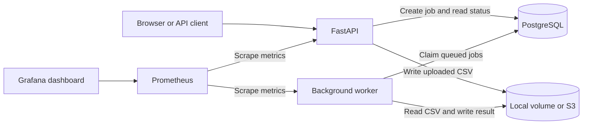

# CloudOps Control Center

A data processing platform that demonstrates an API, PostgreSQL-backed worker queue, containerized services, CI, and application monitoring. Run the full stack locally with Docker Compose, or optionally deploy a single EC2 demo host inside the Terraform-managed AWS VPC. The AWS database remains private and the demo host is accessed through Systems Manager port forwarding.

## Project highlights

- Upload and process CSV jobs through a FastAPI web interface and REST API.
- Track durable job state in PostgreSQL; a separate worker claims jobs safely using `FOR UPDATE SKIP LOCKED`.
- Store inputs and JSON results locally, or use S3 in the AWS deployment.
- Observe API and worker metrics with Prometheus and Grafana.
- Validate changes with automated tests, linting, migrations, container builds, and GitHub Actions.
- Demonstrate the same core services with Docker Compose, local Kubernetes, and optional Terraform-managed AWS infrastructure.

## Architecture



For local development, the services run with Docker Compose or the optional Kubernetes manifests. The AWS example places EC2 and RDS in a Terraform-managed VPC, keeps RDS private, uses an EC2 IAM role for prefix-scoped S3 access, and reaches the app through Systems Manager port forwarding.

## Portfolio walkthrough

1. Start the local stack and use **Run sample data** to submit a job.
2. Confirm the job succeeds and inspect its JSON result through the API.
3. Open Grafana and view request rate and latency metrics; check Prometheus targets if a service is missing.
4. Follow [the Kubernetes walkthrough](docs/kubernetes.md) to run the API, worker, PostgreSQL, Prometheus, and Grafana on a local cluster.
5. Review [the AWS architecture and operations notes](docs/architecture.md) and Terraform modules for the optional cloud deployment.

The project is a portfolio demonstration rather than a public production service. It has no application authentication, and its worker does not yet implement automatic retry or stale-job recovery; see [security notes](docs/security.md) and [operations notes](docs/operations.md).

## Start locally

Prerequisites: Docker Desktop with its Linux container engine running, and Docker Compose v2 or later.

```powershell
docker compose up --build
```

Open these local pages:

- Dashboard: http://localhost:8080
- API documentation: http://localhost:8080/docs
- Grafana: http://localhost:3001 (local demo login: `admin` / `admin-local-only`)
- Prometheus: http://localhost:9091

Select **Run sample data** to queue the included sample in the UI, or upload a UTF-8 CSV smaller than 5 MB. The processor counts valid and rejected rows, totals an optional `amount` column, and groups an optional `category` column. An amount that cannot be parsed rejects that row. Other CSVs are accepted and counted without those optional summaries.

Stop services with `Ctrl+C`, or from another PowerShell window run:

```powershell
docker compose down
```

This keeps the database and Grafana volumes. To reset the demo database and monitoring state, run `docker compose down --volumes`; that permanently removes those local Docker volumes.

## Services

| Service | Purpose | Local port |
|---|---|---:|
| FastAPI | Job API, dashboard, health, and API metrics | 8080 |
| PostgreSQL | Durable job state and summaries | 5432 (container network only) |
| Worker | Claims and processes queued CSV jobs | Metrics 8001 (container network only) |
| Prometheus | Scrapes API and worker metrics | 9091 |
| Grafana | Provisioned operations dashboard | 3001 |

The optional AWS Compose stack is in `compose.aws.yaml`. Terraform provisions a private RDS database, a versioned private S3 bucket, and an EC2 instance profile with prefix-scoped object access. AWS uploads and JSON results are stored under the `incoming/` and `results/` S3 prefixes; the worker downloads each input for processing and removes it afterward. The EC2 host runs the app and monitoring containers with ports bound to loopback; access them through Session Manager port forwarding. It does not expose inbound ports to the internet.

The worker claims jobs with PostgreSQL row locks (`SKIP LOCKED`), so two workers can safely share the queue. Uploads are size-limited and named with generated IDs; original user paths are never used for storage paths. The API and worker run as a non-root container user.

## Useful commands

```powershell
docker compose ps
docker compose logs -f api worker
docker compose config
```

Health endpoints: `/health/live` and `/health/ready`. Job endpoints start at `/api/v1/jobs`; completed JSON results are available at `/api/v1/jobs/{job_id}/result`. Prometheus metrics are at `/metrics` on the API and worker.

## Database migrations and tests

Compose applies versioned Alembic migrations before starting the API and worker. CI applies migrations to PostgreSQL, runs the automated suite, lints and compiles the Python code, and builds the container image.

Run the suite in a disposable container with an isolated SQLite database:

```powershell
docker compose --profile test run --build --rm test
```

For host development, install the development dependencies and run tests with an isolated SQLite database:

```powershell
python -m pip install -e ".[dev]"
python -m pytest
```

## Configuration

Compose has local-only defaults so the first run is quick. Before sharing the machine or exposing ports beyond localhost, create a `.env` from `.env.example` and set unique local credentials. Never put cloud credentials or real customer data in this repository. The demo uses local ports and has no authentication, so keep it on a trusted development machine.

## Repository map

```text
app/                 FastAPI routes, persistence, metrics, and dashboard
worker/              PostgreSQL queue consumer and CSV processing
monitoring/          Prometheus scrape config and provisioned Grafana dashboard
tests/               API and worker behavior tests
migrations/          Alembic environment and versioned schema revisions
infra/terraform/     Optional AWS networking, data, storage, and IAM example
docs/                Architecture, security, and operations notes
.github/workflows/   Test, lint, compile, migration, and container validation
```

## Roadmap

- [x] Local API, database, worker, dashboard, and observability stack
- [x] Container health checks and non-root application container
- [x] CI static checks and image build
- [x] Automated test suite and database migrations
- [x] Terraform AWS VPC, private RDS, S3, IAM, and optional SSM-managed EC2 app host
- [x] Route AWS job uploads and results through the provisioned S3 bucket
- [x] Optional Kubernetes manifests and local cluster walkthrough
- [ ] Capture final screenshots and record a short project demo
- [ ] Verify one end-to-end AWS S3 upload and processing run

The local Kubernetes deployment walkthrough is in [docs/kubernetes.md](docs/kubernetes.md). It deploys the API, worker, PostgreSQL, Prometheus, and Grafana to a local cluster. S3 is used by the AWS Compose deployment; Kubernetes runs with local persistent storage by default.

The AWS and Kubernetes deployments are optional extensions; the local Compose stack needs no cloud account. Free-tier eligibility and pricing vary, so check current provider pricing before creating cloud resources.

See [the LinkedIn post draft](docs/linkedin-post.md) for a concise project summary that can be adapted when sharing the demo.
